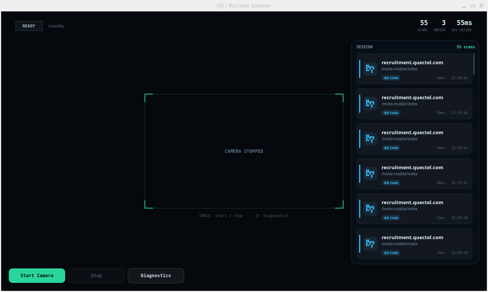
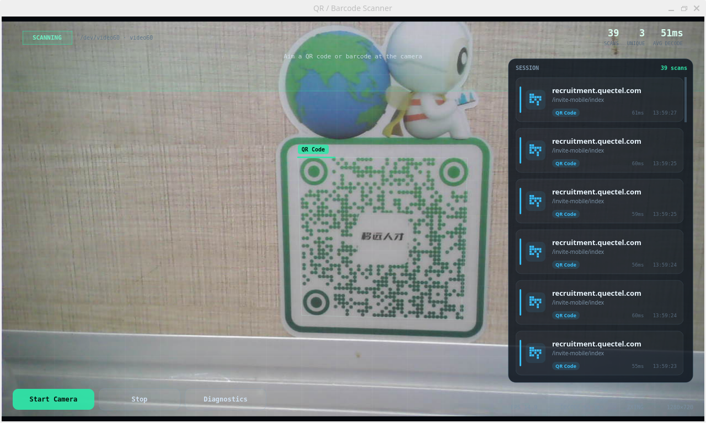
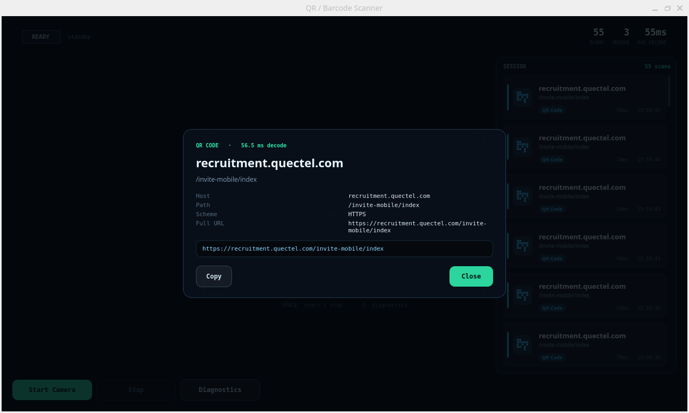

# demo-qr-scanner

[English](README.md)

基于 PySide6 + OpenCV 的扫码 Demo，工业 HUD 风格：实时多码跟踪、智能内容解析、会话式结果流。

整个窗口就是取景画面，状态栏、锁定框、结果卡片、详情浮层全部浮在画面之上。




## 功能特性

- **工业 HUD 视觉**：扫描线、中央准星、四角括号框；每个码的外框会随稳定度绕轮廓逐步点亮，识别成功时整屏白色闪光。
- **多码 + 会话式**：画面里有多少码就同时跟踪多少，摄像头不会因为扫到第一个码就停下，结果持续进入右侧会话栏。
- **稳定帧确认**：同一个内容必须连续 3 帧解码成功才入架，滤掉抖动和误识别；码离开画面 2 帧后解除锁定，可以再次扫描。
- **智能内容解析**：把原始字符串变成可读信息（URL / Wi-Fi / 联系人 / 商品码 / 电话 / 邮件 / 纯文本），商品码会做 GTIN 校验位验证和 GS1 国家前缀查询。
- **详情浮层**：点击卡片或画面上的锁定框，查看结构化字段 + 原始 payload，支持一键复制。
- **诊断抽屉**：当前解码后端、分辨率、帧率、解码耗时和实时日志。
- **音效反馈**：运行时生成 1500 Hz + 3000 Hz 短促提示音。

## 工作原理

```
CameraThread  ──最新帧（单槽覆盖）──▶  DetectionWorker
(OpenCV VideoCapture)                 (降采样 + 解码)
      │                                      │
      └────────▶ GUI 渲染定时器（33 ms）◀─────┘
                          │
                    ScannerView / HUD
```

- **采集与解码分离**：摄像头线程只负责取流，把最新一帧放进互斥锁保护的单槽；解码慢多少都不会让采集队列堆积。
- **永远只处理最新帧**：旧帧直接丢弃，延迟保持恒定而不是越拖越长。
- **降采样解码**：先把画面缩到 960 宽再灰度化解码，四角坐标按比例还原到原图坐标系，720p 下耗时约减半。
- **后端优先级**：`zxing-cpp` → `pyzbar` → OpenCV 内置检测器。缺哪个就自动降级，当前生效的后端显示在诊断抽屉里。
- **解码节流**：限制在约 20 fps（最小间隔 45 ms），4 核 ARM 板不会再被吃满一个核，手感上没有区别。

## 环境要求

- Python 3.9+
- UVC 摄像头（内置或 USB 均可），默认请求 1280×720 MJPG
- Debian / Ubuntu 上还需要 `python3-venv`（虚拟环境工具）和 `libzbar`（`pyzbar` 依赖的系统 C 库）

```bash
sudo apt update
sudo apt install -y python3-venv libzbar0t64   # 当前演示设备为 Debian 13；Debian 12 / Ubuntu 用 libzbar0
```

创建虚拟环境并安装项目依赖：

```bash
cd qr_scanner
python3 -m venv .venv
source .venv/bin/activate
pip install -r requirements.txt
```


## 运行

```bash
# 启动项目
python3 src/main.py
```

启动后点击Start Camera，会自动开始扫码，效果如下



### 环境变量

| 变量 | 默认值 | 说明 |
| --- | --- | --- |
| `SCAN_STABLE_FRAMES` | `3` | 入架前需要的连续成功帧数。调小锁得更快，调大更不容易误识别。 |

## 支持的解析类型

| 类型 | 输入示例 | 卡片展示 |
| --- | --- | --- |
| `url` | `https://www.quectel.com/product/rm520n` | 域名、路径、协议 |
| `wifi` | `WIFI:T:WPA;S:Quectel-Demo;P:12345678;;` | SSID、加密方式、密码 |
| `contact` | `BEGIN:VCARD...` / `MECARD:N:Zhang;TEL:...;;` | 姓名、电话、邮箱、公司 |
| `gtin` | `6901234567892` | GS1 国家、校验位结果、ISBN 识别 |
| `phone` | `tel:+8613800138000` | 号码 |
| `text` | 其他内容 | 原文与长度 |

## 界面说明

界面分五块：顶栏、取景区、右侧会话栏、底部按钮，以及按需弹出的浮层。

### 顶栏

| 元素 | 含义 |
| --- | --- |
| 状态胶囊 | `READY` 待机 / `CONNECTING` 正在打开摄像头（黄）/ `SCANNING` 扫码中（绿）/ `ERROR` 出错（红） |
| 胶囊右侧小字 | 当前摄像头节点与型号，如 `/dev/video60 · UGREEN Camera 2K` |
| `SCANS` | 本次会话累计入架次数，同一个码重复扫会继续累加 |
| `UNIQUE` | 去重后的不同内容数量，同一个码扫 5 次仍只算 1 |
| `AVG DECODE` | 所有入架记录的平均解码耗时 |

### 取景区

| 元素 | 含义 |
| --- | --- |
| 扫描线 / 中央准星 | 运行中的视觉指示，只在扫码状态下显示 |
| 四角括号框 | 检测到码的位置；外框边框会按稳定度绕轮廓逐步点亮，绕满一圈即入架 |
| 码制标签 | 识别出的码类型，如 `QR Code`、`EAN-13` |
| 白色闪光 | 入架成功时的一次性反馈 |
| 顶部提示文字 | `Aim a QR code or barcode at the camera` |
| 右下角读数 | `FPS` 采集帧率、`DECODE` 单次解码耗时、解码后端（如 `ZXING`）、画面分辨率 |
| 中央文字 | 未启动时显示 `CAMERA IDLE`，停止后显示 `CAMERA STOPPED` |

### 右侧会话栏

| 元素 | 含义 |
| --- | --- |
| `SESSION` | 会话标题，右侧 `n scans` 与顶栏 `SCANS` 同步 |
| 左侧色条 | 内容类型：蓝 = URL、绿 = Wi-Fi、紫 = 联系人、黄 = 商品码、灰 = 文本 |
| 标题 / 副标题 | 解析出的主要信息，例如域名 + 路径 |
| 码制 chip | 该条记录对应的码类型 |
| `56ms` / 时间 | 该次解码耗时与入架时间（时:分:秒） |
| 点击卡片 | 打开详情浮层 |
| 空状态 | `No scans yet. Point the camera at a code.` |

### 底部按钮

| 按钮 | 作用 |
| --- | --- |
| `Start Camera` | 打开摄像头并开始扫码，运行中置灰 |
| `Stop` | 停止扫码并释放摄像头，未运行时置灰 |
| `Diagnostics` | 打开 / 关闭诊断抽屉|

### 详情浮层

点击结果卡片或画面上的锁定框弹出。

| 元素 | 含义 |
| --- | --- |
| 顶部小字 | 码制 + 该次解码耗时，如 `QR CODE · 56.5 ms decode` |
| 标题 / 副标题 | 解析后的主标题与补充信息 |
| 字段网格 | 按内容类型给出的结构化字段（域名、路径、协议、SSID、姓名、国家、校验位等） |
| `RAW PAYLOAD` | 未经处理的原始字符串 |
| `Copy payload` | 复制原始字符串到剪贴板，点击后短暂变为 `Copied` |
| `Close` | 关闭浮层；点浮层外的空白处或按 `Esc` 也可以关闭 |

### 诊断抽屉

| 元素 | 含义 |
| --- | --- |
| `BACKEND` | 当前生效的解码后端：`zxing` / `zbar` / `opencv` |
| `RESOLUTION` | 摄像头实际打开的采集分辨率 |
| `FPS` | 采集帧率 |
| `DECODE` | 最近一次解码耗时 |
| 日志区 | 摄像头打开、掉线重连、后端降级等事件，逐行带时间戳 |

### 快捷键

| 按键 | 作用 |
| --- | --- |
| `Space` | 开始 / 停止扫码 |
| `D` | 打开 / 关闭诊断抽屉 |
| `Esc` | 关闭当前浮层，或停止扫码 |

## 目录结构

```
qr_scanner/
├── requirements.txt
├── README.md            # English
├── README.zh-CN.md      # 中文
└── src/
    ├── main.py          # 编排：线程、稳定帧逻辑、快捷键、音效
    ├── camera.py        # CameraThread：设备查找、取流、最新帧单槽
    ├── detector.py      # CodeDetector（zxing/zbar/OpenCV）+ DetectionWorker
    ├── payload.py       # 原始字符串 -> 结构化 Payload
    ├── preview.py       # ScannerView：全屏取景 + HUD 绘制
    └── hud.py           # 顶栏、结果卡片流、详情浮层、诊断抽屉
```

## 技术支持与贡献

如在使用过程中遇到问题，欢迎在[移远官方论坛](https://forumschinese.quectel.com/c/quectel-pi/)提交技术咨询，移远技术支持团队将及时为您解答。

